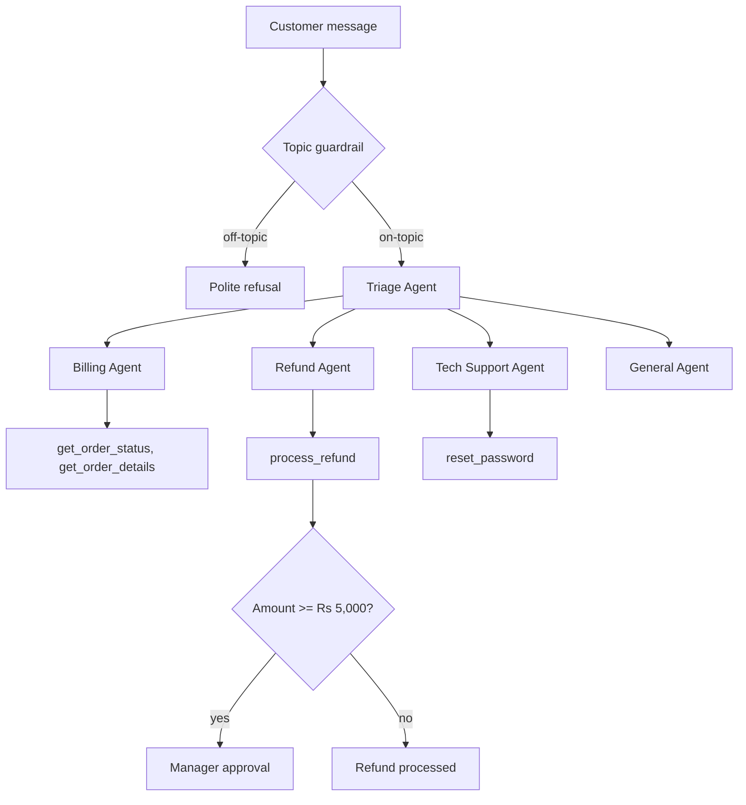

# Customer Support Multi-Agent System

A customer support assistant for a small online shop, built with the OpenAI Agents SDK
and Google Gemini. Instead of one large prompt doing everything, a triage agent reads each
message and hands it to a specialist agent with a narrow job and only the tools it needs.

I built this to learn how multi-agent systems behave in practice: routing, tool use,
guardrails, human approval and conversation memory.

## What it does

- Routes each message to one of four specialists: Billing, Refund, Tech Support or General
- Looks up order status and order details from a data store through function tools
- Processes refunds, with the business rules enforced in Python rather than in the prompt
  (cancelled or already refunded orders cannot be refunded; only delivered orders qualify)
- Pauses refunds of Rs 5,000 or more until a human manager approves or rejects them
- Blocks off-topic requests with an input guardrail before any specialist runs
- Remembers the conversation across turns using an SQLite session
- Handles API errors and rate limits without crashing the chat

## How it works



A few design decisions:

- **Rules live in code, not prompts.** A model can ignore an instruction; an `if` statement
  cannot. Refund eligibility is checked inside the tool itself.
- **Each agent gets the minimum set of tools.** The Billing Agent cannot issue refunds, and
  the triage agent has no tools at all. Fewer options means fewer wrong tool calls.
- **The guardrail runs before the agent, not in parallel.** Off-topic messages are rejected
  without spending extra model calls.
- **Approval depends on the order, not on the tool.** A small refund goes through directly;
  a large one is held for review. This mirrors how most support teams actually work.

## Project structure

```
config.py          Gemini client and model name (single place to change the model)
data.py            Sample orders and user accounts
tools.py           Function tools and the refund approval rule
support_agent.py   The four specialist agents
triage_agent.py    Triage agent with handoffs and the input guardrail
guardrails.py      Topic-checking guardrail using structured output
main.py            Interactive chat loop with memory and approval handling
test_*.py          Scripts I used to test each part on its own
```

## Running it locally

Requirements: Python 3.11+ and a Gemini API key from Google AI Studio.

```
git clone https://github.com/Komal-Mustafa/Customer_Support_Agent.git
cd Customer_Support_Agent
python -m venv .venv
.venv\Scripts\activate          # macOS/Linux: source .venv/bin/activate
pip install -r requirements.txt
```

Create a `.env` file in the project root:

```
GEMINI_API_KEY=your-key-here
```

Start the assistant:

```
python main.py
```

Sample order IDs to try: `ORD-1001` to `ORD-1006`. Each one is in a different state
(delivered, shipped, processing, cancelled, refunded) so you can see how the rules behave.

## Example session

```
You: Hi, my order ID is ORD-1002
Bot [Billing Agent]: Thanks. What would you like to know about order ORD-1002?

You: Where is it now?
Bot [Billing Agent]: Order ORD-1002 has been shipped.

You: Can you solve 2x + 5 = 15 for me?
Bot: Sorry, I can only help with orders, refunds, login and shop questions.

You: I want a refund for ORD-1006, the watch stopped working
MANAGER APPROVAL NEEDED
   Tool: process_refund
   Details: {"order_id": "ORD-1006", "reason": "the watch stopped working"}
   Approve? (y/n): y
Bot [Refund Agent]: Your refund for ORD-1006 has been approved. Rs 25,000 will be
returned in 5-7 working days.
```

## Problems I ran into

**The model I started with was retired.** Partway through, `gemini-2.5-flash` started
returning a 404 for new users. Because the model name is defined once in `config.py`,
switching took one line.

**Free-tier rate limits.** The free Gemini tier allowed 20 requests a day for the model I
used, and a single customer message can take four to six calls (guardrail, triage,
specialist, tool, final answer). I added pauses between test runs, made the guardrail
blocking so rejected messages stop early, and catch 429 errors so the user sees a clear
message instead of a stack trace.

**Testing decorated tools.** Functions wrapped with `@function_tool` become tool objects
and can't be called directly in a test. I kept the plain functions and created the tool
versions at the bottom of `tools.py`, which let me test all the refund rules without
calling the model at all.

**Keeping memory across an approval pause.** When a refund is paused for approval, the
run has to resume from its saved state with the same session, otherwise the agent loses
the conversation. The chat loop resumes with both the run state and the session.

## What I would add next

- A FastAPI backend and a simple web chat page
- A real database instead of in-memory sample data
- An output guardrail to check replies before they reach the customer
- Automated tests with a mocked model so the suite runs without API calls
- Deployment with a public demo link

## Demo

Video walkthrough: _link coming soon_

## Author

Komal Mustafa
LinkedIn:https://www.linkedin.com/in/komal-mustafa/_